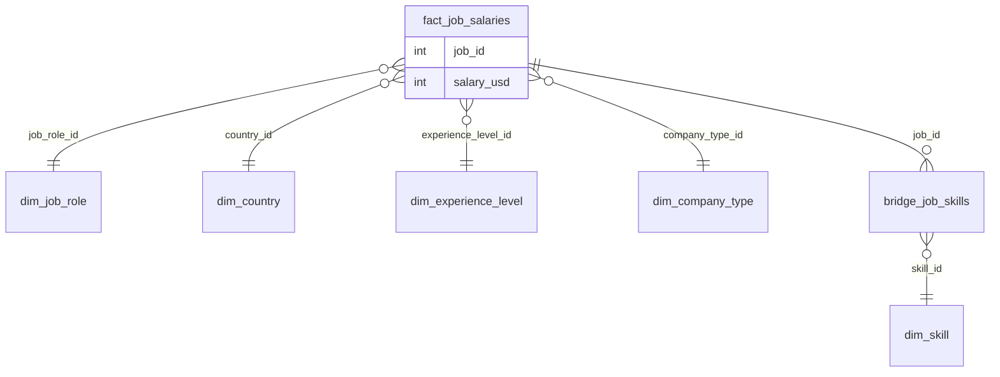

# Рынок труда в AI и Data: зарплаты и навыки

**Нурболот Дженишбеков · Data Analyst** · [LinkedIn](https://www.linkedin.com/in/nurbolot-dzhenishbekov/) · [Все проекты](https://github.com/dzenisbekovnurbolot)

🔗 **[Открыть интерактивный дашборд в Tableau Public](https://public.tableau.com/app/profile/.63882253/viz/Book4_17950780563590/sheet0)**

## Вопрос

От чего сильнее всего зависит зарплата в AI- и Data-профессиях: от уровня опыта, должности, навыков, страны или типа компании?

## Данные

Учебный датасет Kaggle по вакансиям в AI: **10 000 вакансий**, 8 должностей, 4 уровня опыта, 3 типа компаний, 10 навыков (по 3 навыка на вакансию).

Плоскую таблицу я нормализовал в модель «звезда»: факт зарплат, справочники и связующая таблица для навыков (связь «многие ко многим»). В Tableau таблицы связаны через relationships, без дублирования строк при подсчёте вакансий.

## Дашборды

1. **Обзор рынка:** KPI (средняя зарплата, число вакансий, топ-должность), карта зарплат по странам, зарплата по уровню опыта и по должностям.
2. **Навыки и структура рынка:** спрос на навыки, зарплата по навыку (treemap), heatmap «должность × тип компании», топ комбинаций «должность | страна | опыт».

Графики связаны фильтрами-действиями: клик по стране, должности, уровню опыта или навыку фильтрует остальные.

## Выводы

1. **Опыт важнее всего.** Средняя зарплата растёт с $33.8K (Entry) до $67.3K (Mid), $111.6K (Senior) и $166.4K (Lead) — почти в 5 раз.
2. **Должность влияет слабо.** Разброс от $91.8K (AI Engineer) до $99.1K (ML Engineer), около 8%. Самая оплачиваемая роль — ML Engineer.
3. **Навыки почти не меняют зарплату.** От $94.5K (Data Visualization) до $96.6K (Deep Learning), разница около 2%. Спрос на навыки тоже ровный: от 2 903 до 3 102 вакансий; чаще всего требуют SQL.
4. **Тип компании.** Максимум — ML Engineer в компаниях среднего размера ($101K), минимум — Data Analyst в крупных компаниях ($91K).
5. **Ограничение данных.** Слишком ровное распределение навыков и должностей похоже на синтетический датасет: на реальном рынке разброс был бы больше. Проект показывает моделирование данных и построение дашбордов, а не реальную картину рынка.

## Стек

Excel (нормализация, модель «звезда») · Tableau (relationships, вычисляемые поля, фильтры-действия, карты, heatmap, treemap)
